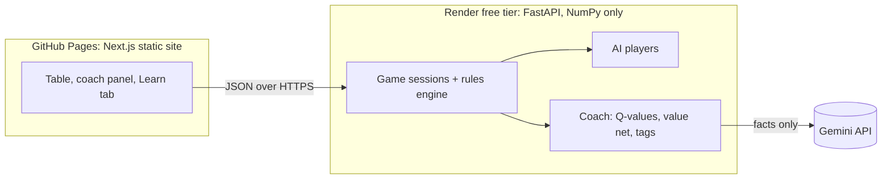

# QRummy

Play a two-player house variant of **Indian Rummy** (3 decks + 6 jokers, 13-card hands, "Game of 7s")
against an AI trained with reinforcement learning, with a coach that shows your chance of winning
and explains every move.

- **Play:** https://coder-r2.github.io/qrummy/
- **API:** https://qrummy-api.onrender.com/api/health (free tier, so the first request after a quiet spell takes ~30 s to wake up)

The site has four parts: **Home**, **Rules** (the full house rules with card examples), **Play the AI**
(Easy / Medium / Hard, optional coach) and **Learn** (a guided round, 60 puzzles, strategy notes).

## How it works



| Piece | What it does |
|---|---|
| `indian_rummy/` | Rules engine. `game.py` runs a round, `melds.py` validates rummies, and `solver.py` finds the lowest-points arrangement of any hand and checks wins (exact 3/3/3/4). `features.py` turns a player's view into a 1,098-number observation. |
| `indian_rummy/agents/` | A hand-written **heuristic** player, the **DQN** policy, the **hybrid** (DQN picks among the heuristic's top 3 discards), and `np_models.py`, the NumPy-only inference used in production. |
| `training/` | RLCard DQN training (`train_dqn.py`), value-net training (`train_value.py`), evaluation, export to `.npz`, and generators for the puzzles and strategy stats. |
| `server/` | FastAPI backend: sessions, the AI for each difficulty, the coach, and Gemini explanations with a template fallback. The server only ever sends what the player is allowed to see. |
| `web/` | Next.js 16 static export with Tailwind and Motion animations. |

### The AI

The DQN ([RLCard](https://github.com/datamllab/rlcard) [Zha et al., IJCAI 2020](#acknowledgements), PyTorch)
chooses draws, discards and forfeits. The solver handles meld arrangement,
the reveal and the declaration.

1. **Imitation (DQfD).** The network first learns from the heuristic's games, using a large-margin
   imitation loss plus the usual TD loss.
2. **Self-play RL.** Three overnight runs followed, with potential-based reward shaping, clipped targets,
   a Huber loss, and in the last run a conservative Q-learning (CQL) penalty against Q-value overestimation.

Each run's RL phase made the network weaker than it was after imitation. The shipped network is therefore
the pretrained one. The evaluation over 4,000 rounds against the heuristic, with seats alternating:

| Player | Win rate vs heuristic |
|---|---|
| Heuristic (seat baseline) | 51.0% |
| Hybrid (DQN + heuristic top 3) | 48.2% |
| DQN alone | 38.3% |
| Heuristic with 30% random moves | 30.5% |

The DQN alone beats a random player 95.8% of the time. The difficulty levels follow from this:
**Hard** is the heuristic (the strongest player), **Medium** is the DQN alone, and **Easy** is the heuristic
with 35% random moves.

**Coach.** A separate value network (trained on 446k positions) estimates your chance of winning. Its
expected calibration error is 0.02 on held-out games. The coach ranks every legal move using the DQN's
Q-values, with the hybrid's choice first, and tags each move with concrete reasons (points left, outs, dead
cards, cards the AI may want). Gemini turns those facts into one or two sentences; if it is slow or
unavailable, the built-in template text stays.

Full details: `models/model_card.json`.

## Run it locally

Requires Python 3.13 and Node 22.

```bash
# backend (NumPy only, the same as production)
python -m venv .venv && .venv/Scripts/activate      # or: source .venv/bin/activate
pip install -r server/requirements.txt
uvicorn server.server:app --port 7860

# frontend (talks to http://localhost:7860 by default)
cd web && npm ci && npm run dev
```

Gemini explanations are optional: copy `.env.example` to `.env` and set `GEMINI_API_KEY` and `GEMINI_MODEL`.
Without them the coach uses template text.

### Tests

```bash
pip install -r requirements.txt   # dev/training environment (adds rlcard, pytest)
pytest -m "not slow"              # fast suite
pytest                            # everything, including 50 full matches and solver-vs-oracle checks
```

### Training

```bash
pip install torch==2.11.0 --index-url https://download.pytorch.org/whl/cu130
python training/train_dqn.py --run C --hours 9          # pretraining, then RL; checkpoints in models/checkpoints/C
python training/train_value.py --data training/data/C   # value net from states logged during training
python training/evaluate.py --a models/checkpoints/C/pretrained.pt --b heuristic --rounds 4000
python training/export_models.py --dqn models/checkpoints/C/pretrained.pt --out models/dqn_model.npz
python training/export_models.py --value models/value_model.pth --out models/value_model.npz
```

## Acknowledgements

The agent is built on **[RLCard](https://github.com/datamllab/rlcard)** (MIT licence): its environment
interface and DQN agent, which `training/train_dqn.py` extends (ring replay buffer, DQfD margin loss, CQL
penalty). The Indian Rummy environment in `indian_rummy/rlcard_env.py` is registered with RLCard.
If you build on this work, please cite RLCard:

> Daochen Zha, Kwei-Herng Lai, Songyi Huang, Yuanpu Cao, Keerthana Reddy, Juan Vargas, Alex Nguyen, Ruzhe Wei,
> Junyu Guo and Xia Hu. **RLCard: A Platform for Reinforcement Learning in Card Games.** In *Proceedings of
> IJCAI*, 2020.

```bibtex
@inproceedings{zha2020rlcard,
  title={RLCard: A Platform for Reinforcement Learning in Card Games},
  author={Zha, Daochen and Lai, Kwei-Herng and Huang, Songyi and Cao, Yuanpu and Reddy, Keerthana and Vargas,
          Juan and Nguyen, Alex and Wei, Ruzhe and Guo, Junyu and Hu, Xia},
  booktitle={IJCAI},
  year={2020}
}
```

## Deployment

- **Frontend:** `.github/workflows/pages.yml` builds the static site on every push to `main` and
  publishes it to GitHub Pages.
- **Backend:** Render builds the root `Dockerfile` from `render.yaml` (Python slim, NumPy, no torch).
  - `backend-image.yml` smoke-tests the image in CI.
  - `keep-warm.yml` pings the API every 10 minutes so the free instance stays awake.

## License

[MIT](LICENSE) © 2026 Rishe. RLCard, which this project builds on, is also MIT-licensed.
